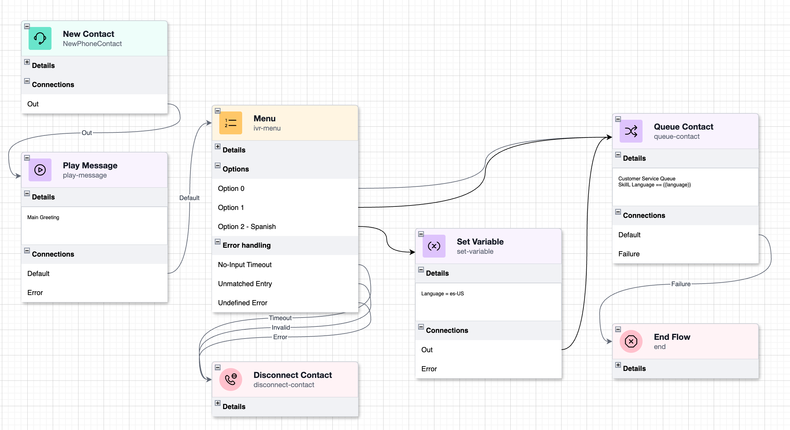
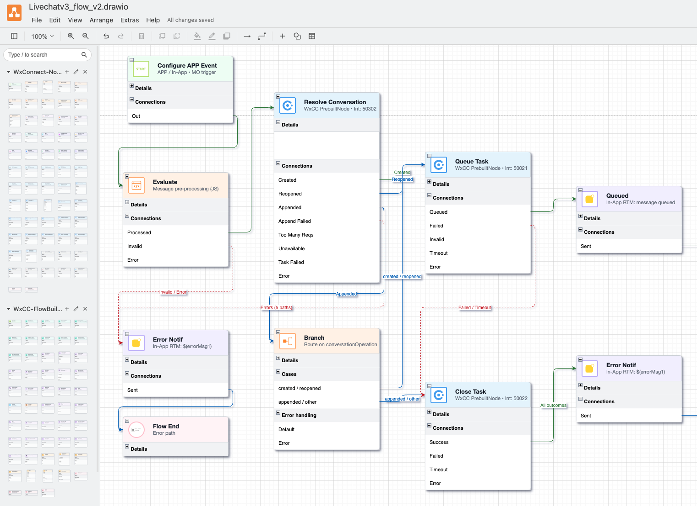

# Webex Flow Designer draw.io Libraries

draw.io shape libraries for designing **Webex Contact Center (WxCC)** and **Webex Connect** flow diagrams. Each library mirrors the activity palette of its respective designer so diagrams look like the real tool without needing a live environment.

---

## Libraries

### Webex Contact Center (WxCC)

`WxCC-FlowBuilder-Activities.xml` contains 71 activity and event nodes matching the WxCC Flow Builder palette, plus 3 pre-styled connector shapes (Normal, Error and Timeout paths).



`sample_flow.drawio` is the diagram shown above. Open it in draw.io to see how the nodes and connectors fit together.

### Webex Connect

`WxConnect-Node-Library.xml` contains nodes matching the Webex Connect flow designer.



---

## Importing a Library

1. Open [app.diagrams.net](https://app.diagrams.net) or the draw.io desktop app.
2. Go to **File > Open Library from > This Device**.
3. Select the `.xml` file for the library you want to use.
4. The library panel appears in the left sidebar. Drag any shape onto the canvas to use it.

You can import both libraries at the same time. Each appears as its own panel.

---

## WxCC Node Categories

| Category | Badge Color | Example Nodes |
|---|---|---|
| Start | Green (`#BCE36F`) | Start Flow |
| Event | Teal (`#74E8D1`) | New Contact, Agent Offer, Contact Ended |
| Action | Purple (`#E2CAFC`) | Play Message, Collect Digits, Queue Contact, HTTP Request |
| Gateway | Yellow (`#FFCE73`) | Menu, Case, % Allocation, Condition, Business Hours |
| Subflow | Blue (`#99DDFF`) | Subflow |
| Function | Orange (`#FEBA7F`) | Function |
| Terminating | Pink (`#FFC7D2`, pill) | Blind Transfer, Disconnect Contact |
| End | Pink (`#FFC7D2`, pill) | End Flow, GoTo |

---

## Library Tiles Are Collapsed

Each shape appears in the library panel as a small icon-only tile, so the panel stays compact and easy to scan. Hover a tile to see the node name.

When you drop a shape on the canvas it starts collapsed. Click the **+** in its title bar to expand it to the full card, which shows Details and exit connections. Click **-** to collapse it again.

---

## Node Anatomy (WxCC)

An expanded node is a stacked swimlane card divided into collapsible sections:

```
+--------------------------------------------------+
|  [badge]  Node Name              (header)        |
|           subtitle                               |
+--------------------------------------------------+
|  + Details                       (collapsed)     |
+--------------------------------------------------+
|  - Connections                   (expanded)      |
|    Default                              o        |
|    Error                                o        |
+--------------------------------------------------+
```

- **Header**: category badge icon, node name and API activity name. Long text is truncated, and hovering shows the full name. The input point is on the left edge, level with the icon.
- **Details**: collapsed by default. Expand it to see a table of the activity's input fields (name, type, required) and, for activities with outputs, a second table of output variables. See the next section for how to add values.
- **Connections**: one row per exit path, each with a hollow dot on the right edge. Dots are blue for normal exits, red for error exits and brown for timeout exits.

Variable-exit nodes (Menu, Case, % Allocation) have an **Options / Cases / Allocations** section and a separate **Error handling** section. Event nodes show their source, classification and event name in Details.

---

## Filling in Values

Under every input field and output variable in Details is an empty Value row, shown as a light blue box with a blue bar on its left edge.

1. Click the **+** on the Details header to expand it.
2. Double-click inside the Details area.
3. Click into the blue Value row under the field you want and type.

Text wraps inside the row. The card height is fixed, so if a long value pushes content past the bottom, drag the card taller.

---

## Connecting Nodes

Use the connector shapes at the top of the library for colored wires:

| Connector | Color | Use for |
|---|---|---|
| Normal Path | Blue | Default and option exits |
| Error Path | Red | Error and failure exits |
| Timeout Path | Brown | Timeout and invalid exits |

Draw.io cannot color a wire automatically based on the port it leaves from, so pick the connector that matches the exit. Each connector starts with a filled dot and ends with an arrow.

- **Exit ports**: the dot on the right edge of each row in Connections. Drag from a dot to the target node.
- **Entry point**: the left edge of the header. Dropping a line on the node outline attaches it to the left side at the middle of the card. For a connection level with the icon, drop directly on the input point.

Use **View > Connection Points** to display all ports while editing.

---

## Adding and Removing Rows

Variable-exit nodes (Menu, Case, % Allocation) support editable exit rows:

- **Add a row**: right-click the node and select **Add Row**, or duplicate an existing row.
- **Remove a row**: select the row and press Delete. The layout reflows automatically.
- **Rename a row**: double-click the row label and type the new name.

Fixed-exit nodes have pre-defined exits that match the WxCC designer. Avoid deleting these unless the exit does not apply to your flow.

---

## Regenerating the Library

`generate_library.py` builds the WxCC library. With a bearer token it also fills each node's Details tables from the live WxCC activities and event-specifications APIs.

```bash
python3 generate_library.py WxCC-FlowBuilder-Activities.xml --token <bearer token>
```

- Always build with `--token` before committing. Without it the Details tables are empty.
- Add `--expanded` to drop shapes fully expanded instead of collapsed to the title bar.
- The token is a WxCC bearer token for your org. The org ID is read from the token.

`build_sample_flow.py` rebuilds `sample_flow.drawio` from the generated library, so the sample always matches the shapes:

```bash
python3 build_sample_flow.py WxCC-FlowBuilder-Activities.xml sample_flow.drawio
```
